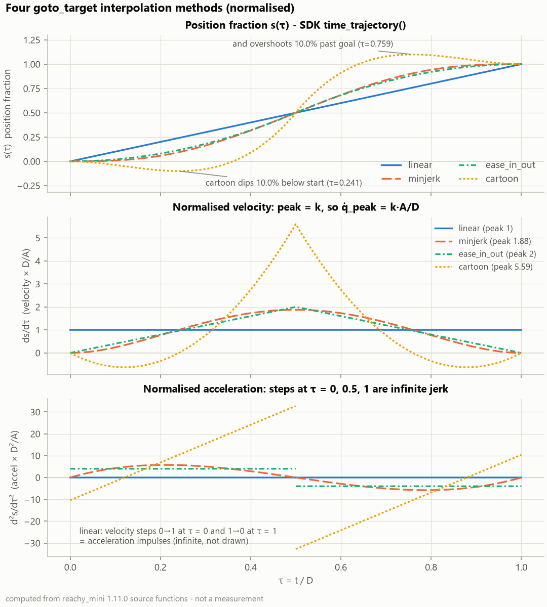
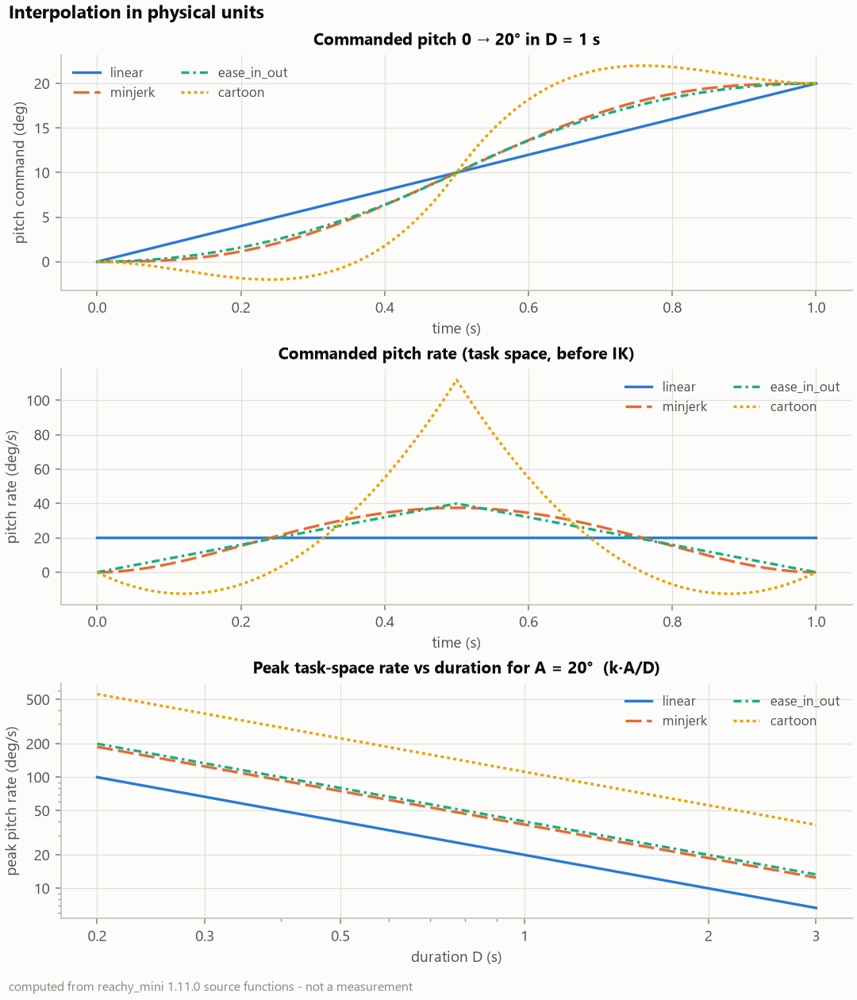
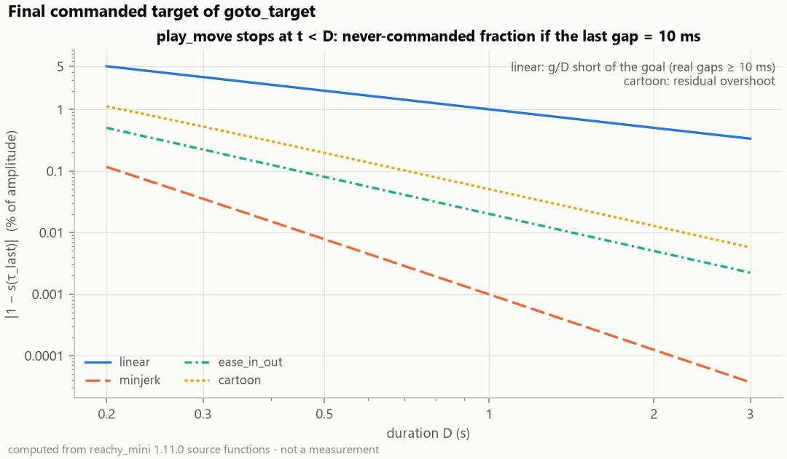
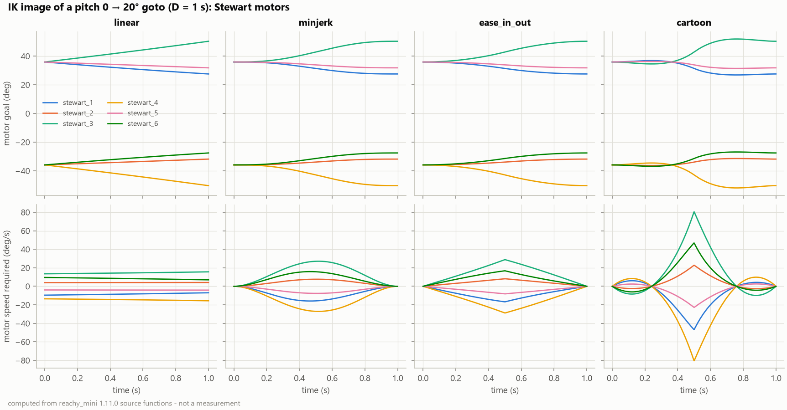
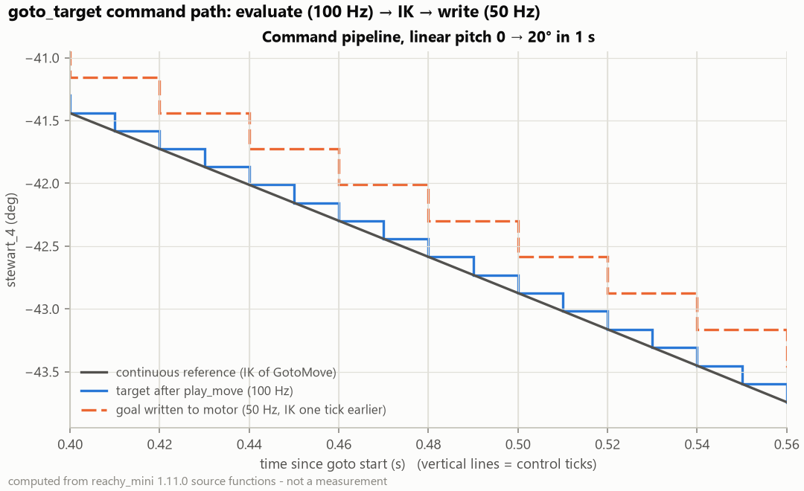
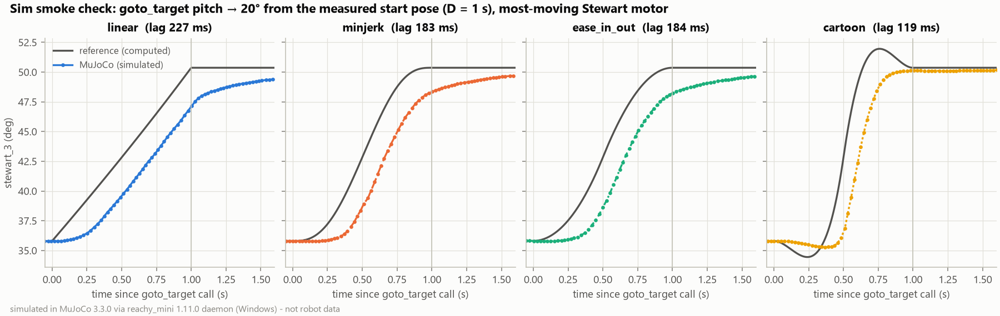

# Phase 1 — Reachy Mini SDK 1.11.0 분석 보고서

작성 2026-11-10 · 대상 `reachy-mini 1.11.0` (+ `reachy-mini-rust-kinematics 1.0.3`, `reachy-mini-motor-controller 1.5.6`)
· 근거 줄 번호는 모두 `.venv/Lib/site-packages/` 기준 · 재현: `python -m reachy_motion phase1`, `python -m reachy_motion sim-smoke`
· 주장별 근거·교차 검증 판정: [SOURCE_REFERENCES.md](SOURCE_REFERENCES.md)

**근거 표기** — `[S]` 소스 코드로 확인 · `[C]` SDK 함수를 호출해 계산(computed) · `[Sim]` 로컬 MuJoCo daemon 시뮬레이션(simulated)
· `[D]` 공식 문서/데이터시트 · `[P]` 컴파일 확장(.pyd)을 실험으로 추정 · `[PC]` 이 PC에서의 stdlib 측정·스텁 재현(daemon 아님)
· `[HW3]` HW3 실기기 기록(HW4 측정 아님).
실기기 측정값은 이 보고서에 **없다**(로봇 오프라인, 실기기 실험은 승인 전 금지).

---

## 0. 핵심 결론

1. **`goto_target()`은 클라이언트에서 보간하지 않는다.** WebSocket `TaskRequest` → daemon이 **현재 측정 자세**에서 시작하는
   `GotoMove`를 만들어 `play_move`가 **100 Hz**로 평가 → 50 Hz 제어 루프가 최신 목표를 IK → 모터. 호출자는 `duration + 1 s`까지 블록된다. [S]
2. **daemon 측 goto 진입점 중 보간법이 적용되는 것은 Python SDK의 `goto_target`뿐이다.** REST `/api/move/goto`와 typed `goto_target`
   명령(WebRTC·JS)은 `method`를 버려 항상 MIN_JERK. 클라이언트 측 `play_move(GotoMove)`나 자체 스트리밍은 어떤 방법이든 쓸 수 있다. [S]
3. **`body_yaw`의 기본값은 `0.0`이다** — 생략하면 몸통이 0 rad로 돌아간다(`None`이어야 유지). [S]
4. **끝점은 정확히 명령되지 않는다.** `play_move`는 `t < D` 동안만 평가하고 끝에 목표를 다시 쓰지 않는다(SDK 주석이 인정).
   미달량 = 1 − s(1 − g/D), g = 마지막 평가 뒤 D까지의 간격. 공칭 g = Δt = 10 ms면 LINEAR는 Δt/D(D = 0.3 s → 3.3 %), 나머지는
   무시할 수준 — 실제 간격은 Δt + 깨어남 지연이라(Windows에서는 들쭉날쭉) 실제 최악은 이보다 크다(로봇 미측정). [S][C]
5. **보간 4종 피크 속도 = k·A/D** — linear 1, minjerk 1.875, ease_in_out 2, **cartoon 5.595**. cartoon은 시작 전 −10.0 %,
   목표 후 +10.0 %로 **명령 자체가 구간 밖으로 나간다**. 가속도 연속은 minjerk뿐. [C]
6. **IK는 닫힌 형식(Rust)이고 관절 한계·충돌을 검사하지 않는다.** NaN일 때만 실패 → daemon은 경고만 남기고 **직전 관절 목표 유지**,
   클라이언트는 성공으로 받는다. 자동 body yaw 모드에서만 yaw를 조용히 클램프(상대 65°, 몸통 160°). [S][P]
7. **제어 주기는 세 백엔드 모두 50 Hz.** 실기기는 tick마다 "이전 IK 결과 write → read → IK" 순서라 머리 명령이 **한 tick(20 ms) 늦게**
   모터에 가고, IK가 필요 없는 안테나는 다음 tick에 바로 쓰여 **머리보다 ≈ 20 ms 앞선다**(mockup도 같음). MuJoCo는 둘 다 같은 tick.
   명령 경로만의 지연 모델: 실기기 30–40 ms(평균 35), MuJoCo 구조 10–20 ms(평균 15). [S][C]
8. **명령값(target)은 어떤 공개 채널로도 나오지 않는다.** `/api/state/full?with_target_*`는 응답 모델이 필드를 버린다(로컬 sim 실증:
   `results/phase1/sim_smoke/api_checks.json`).
   측정값 push(50 Hz)에는 타임스탬프가 없다 → HW4가 명령은 직접 기록, `goto_target` 명령은 `GotoMove`로 재구성해야 한다. [S][Sim]
9. **Stewart 관절 한계(URDF = MJCF = EEPROM)**: s1/s3 [−48, +80]°, s2 [−80, +70]°, s4/s6 [−80, +48]°, s5 [−70, +80]°.
   몸통 ±160°는 URDF/MJCF와 자동 body yaw IK 클램프에만 있고, **몸통·안테나의 EEPROM 한계는 한 바퀴 전체(0–4095)라 펌웨어가 보호하지 않는다**.
   공식 DOF 표는 roll·pitch ±40°지만 **1.11.0은 이를 클램프하지 않는다**(업스트림 이슈 #1449). [S][D]
10. **모터(공식)**: Stewart 6× XL330-M288-T, 안테나 2× XL330-M077-T, 몸통 1× XC330-M288-PG. 무부하 속도(6 V) 738 / 2736 / ≈582 °/s.
    Profile Velocity를 쓰지 않아 50 Hz마다 계단 목표를 P 제어(P = 300/200, D = 0)로 따른다. [D]
11. **Windows에서 돌린 sim daemon은 로봇과 타이밍이 다르다**: asyncio 타이머가 ≈ 15.6 ms 단위로 동작해 goto 평가 주기가 100 Hz가 아니다
    (SDK goto 중에는 WS 브로드캐스트의 깨움 때문에 불규칙 ≈ 100–145 Hz, 클라이언트 측 루프는 ≈ 60 Hz — 스텁 재현, 실행 중 daemon은 미측정),
    MuJoCo 루프는 실시간의 ≈ 0.8–0.86배(측정 push 간격 중앙 23–25 ms, 실행마다 다름). sim 지연·RMSE는 하드웨어 예측으로 쓰지 않는다. 로봇 daemon은 CM4(Linux)에서
    돌므로 이 양자화와 무관하다(로봇 주기는 미측정). [PC][Sim]
12. **요구 모터 속도(예비)**: IK로 미분한 Stewart 피크 속도 ÷ 무부하 속도(XL330-M288-T 5 V)는 D = 0.3 s의 가장 큰 진폭(pitch·roll 30°,
    yaw 60°, z −20 mm)에서 minjerk·ease 0.23–0.27, **cartoon 0.67–0.76**(격자 전체로는 0.11–0.27 / 0.33–0.76); D = 1 s에서는 모두 ≤ 0.23.
    짧은 cartoon이 하드웨어 한계에 가장 가깝다(§6.6). [C][D]
13. **자동 body yaw의 ψ wrap은 위험하다**: 머리 yaw ψ = atan2(−R₀₁, R₀₀)가 표본 사이에서 ±180°를 가로지르면 보간법과 무관하게
    몸통 목표가 한 표본(10 ms) 사이 ≈ 229–275° 뒤집히고 Stewart 목표도 ≈ 29–36° 점프한다. NaN이 아니어서 daemon이 그대로 보낸다.
    원인은 cartoon 외삽(시작 0°에서 |목표 yaw| > 163.6°, 재현·테스트로 고정) 또는 **기울어진 머리**: 반대 부호 roll·pitch에서는
    |Euler yaw| ≥ 180° − atan(|sin pitch·tan roll|)부터 wrap된다(roll·pitch 20°면 172.9°, 40°면 151.7°; MIN_JERK (20, −20, 160°) →
    (20, −20, 179°), 몸통 140°에서 몸통 목표 140° → −114.9°(255°), Stewart 35.7°). [C][P]

---

## 1. 분석 방법

| 단계 | 내용 | 산출물 |
|---|---|---|
| 정찰 | 설치 버전·소스 위치 확인, HW3·chamchamcham venv의 SDK와 `diff -rq` 동일 확인 | VERIFICATION 기록 |
| 병렬 분석 | 8개 축(goto 경로, 보간 수학, IK, 제어 루프·텔레메트리, 관절 제한, 커스텀 Move API, 공식 문서·모터, HW3 재사용)을 독립 에이전트가 소스 줄 단위로 분석 + 오프라인 수치 실험 | 축별 주장 ~30개 |
| 적대적 검증 | 축마다 별도 에이전트가 각 주장의 인용 줄을 다시 열고 독립 스크립트로 수치를 재계산해 반박 시도 | SOURCE_REFERENCES 판정 |
| 독립 재계산 | `reachy_motion.analysis`가 SDK 함수(`time_trajectory`, `GotoMove`, `AnalyticalKinematics`)를 직접 호출해 그림·표 생성, 58개 단위 테스트(SDK 동작 회귀, AST로 SDK 소스 경로 고정, 독립 유리수 모델 대조 포함)로 고정 | `results/phase1/*` |
| 실증 | 로컬 MuJoCo daemon(127.0.0.1, `simulation_enabled` 확인 후)으로 goto 흐름·텔레메트리 확인 | `results/phase1/sim_smoke/*` |
| 최종 교차 검토 | 완성된 보고서·문서·코드·결과를 5개 관점(goto·제어, 보간·IK, 한계·사양, Phase 0 문서, 코드·테스트)이 다시 검토하고, 제기된 63건마다 별도 에이전트가 반박 검증 → 61건 반영, 2건 기각 | `results/phase1/probes/final_review/`, SOURCE_REFERENCES 정오표 |

에이전트 간 모순은 소스 재확인 또는 sim 실증으로 판정했다(§5.3, §5.5).

---

## 2. `goto_target()` 동작과 구현 구조

### 2.1 호출 경로 [S]

```
사용자 코드 ─ ReachyMini.goto_target(head, antennas, duration=0.5, method=MIN_JERK, body_yaw=0.0)   reachy_mini.py:672-703
   │ GotoTaskRequest{head(16), antennas, duration, method, body_yaw} → TaskRequest{uuid, timestamp}   reachy_mini.py:705-721, io/protocol.py:1081-1106
   │ WSClient.send_task_request → ws://…/ws/sdk                                                        io/ws_client.py:268-280
   │ wait_for_task_completion(timeout = duration + 1.0)  ← 호출 스레드 블록                             reachy_mini.py:722, io/ws_client.py:282-299
   ▼
daemon (uvicorn 메인 이벤트 루프)
   WSServer._recv_loop → _handle_task_request → asyncio.create_task(run_task)                          io/ws_server.py:146-200
   Backend.goto_target(…, method=req.method)                                                            daemon/backend/abstract.py:944-977
     GotoMove(start = get_present_head_pose(), present body yaw, present antennas → target)            motion/goto.py:15-74
     play_move(move, play_frequency=100):                                                               abstract.py:826-942
       while time.time() - t0 < D:  t → evaluate(t) → set_target_head_pose / body_yaw / antennas        abstract.py:904-925
         evaluate: s = time_trajectory(t/D, method); head = linear_pose_interpolation(…, s, yaw_as_scalar=True)
       (루프 후 목표 재기록 없음 — "play_move never evaluates a move at exactly t=duration")              abstract.py:1233-1236
   TaskProgress(finished=True, error) 브로드캐스트 → 클라이언트 Event set                                io/ws_server.py:189-198
   ▼
제어 루프 스레드 (50 Hz)   robot/backend.py:154-262 · mujoco/backend.py:227-288 · mockup_sim/backend.py:73-137
   [실기기] ① 이전 tick의 관절 목표 write → ② 현재값 read + FK → ③ ik_required면 IK(최신 목표) → ④ 측정값 publish
   [MuJoCo] read → IK → data.ctrl 쓰기(같은 tick) → publish → mj_step
```

- `set_target_head_pose`는 목표를 덮어쓰고 `ik_required=True`만 세운다(큐 없음, 최신값 우선; 단 head tracking aim이 있고 weight ≥ 1이면
  `ik_required`를 세우지 않고 aim이 목표를 대체, `abstract.py:606-609`). `ik_required`는 IK 후에도
  해제되지 않아 **Cartesian 목표가 있는 동안 매 tick IK를 다시 푼다**(`abstract.py:596-638, 824`). 코드 주석의 "does nothing if the
  targets did not change"는 사실과 다르다. [S]
- 100 Hz 생산자 / 50 Hz 소비자이므로 모터에 닿는 명령률은 **50 Hz**(평가 표본의 약 절반만 반영). [S]

### 2.2 진입점별 차이 [S]

| 진입점 | method 반영 | body_yaw 기본 | 완료 신호 | 중단 |
|---|---|---|---|---|
| `ReachyMini.goto_target` (Python, /ws/sdk TaskRequest) | **예** | `0.0` (몸통 재정렬) | `TaskProgress`, 호출 블록 ≤ D+1 s | `StopMoveCmd` (ReachyMini 메서드 없음) |
| REST `POST /api/move/goto` | **아니오** (`interpolation` 받고 버림, `move.py:137-149`) | `None` | MoveUUID 즉시, `/api/move/ws/updates` | `POST /api/move/stop` |
| typed `{type:"goto_target"}` (WebRTC, /ws/sdk) | **아니오** (`GotoTargetCmd`에 필드 없음, `protocol.py:234-241`; `abstract.py:1701-1708, 2658-2673`) | `None` | WebRTC만 응답 | `StopMoveCmd` |
| 클라이언트 `play_move(GotoMove)` | 예(클라이언트 평가) | Move마다 | 루프 종료(t ≤ D−0.01로 클램프) | `cancel_move()` |
| 업로드 재생 `UploadMove*` + `PlayUploadedMoveCmd` | (표본을 선형 보간, ≤ 200 Hz) | 프레임마다(누락 시 0) | **ReachyMini 래퍼 없음**, 원시 명령으로 전송은 가능하나 Python 클라이언트가 시작/종료 브로드캐스트를 버림 | `CancelMoveCmd(upload_id)`, `StopMoveCmd` |

업로드 재생은 Python에서 완료를 관찰할 수 없고 실제 daemon에서 시험하지 않았으므로 HW4 핵심 경로에서 제외한다(`protocol.py:668-842`,
`abstract.py:2143-2900`).

### 2.3 설계에 직접 영향을 주는 동작

| 동작 | 근거 | HW4 대응 |
|---|---|---|
| 시작 자세 = **측정** 자세(실기기: 측정 관절의 FK, MuJoCo: head site) → 처짐·지연이 다음 goto의 시작점이 됨 | `abstract.py:966-977` [S] | goto 명령 재구성은 측정 시작 자세 기준 |
| 끝점 미달(LINEAR, 공칭 Δt/D — 실제 최악은 g_max/D) | `abstract.py:904-925, 1233-1236` [S][C] | 스트리밍은 마지막 표본 = 목표. daemon goto는 마지막 명령값을 알 수 없으므로(t_last 미공개) 목표 기준 오차에 [0, 1 − s(1 − g_max/D)] 끝점 불확실성을 붙이거나, 비교 실험은 스트리밍으로 |
| move 실행 중 `set_target` 계열은 **무시**(daemon 경고만, ack는 ok) | `abstract.py:1661-1699` [S] | goto와 스트리밍 혼용 금지, 단일 실행 스레드 |
| 같은 이벤트 루프의 goto 2개는 RLock 재진입으로 **동시에 실행되어 목표가 섞임**, 다른 스레드의 goto는 무시되지만 "성공" 보고 | `abstract.py:282-286, 488-499, 844-846` [S] (오프라인 하네스로 재현) | Executor가 직렬화, 완료 판정은 측정값으로 |
| `TimeoutError`가 나도 daemon move는 계속됨 | `io/ws_client.py:282-299` [S] | 타임아웃 후 `StopMoveCmd` 후 재시도 |
| 중단 수단은 `StopMoveCmd`뿐(마지막 목표에서 감속 없이 정지, 클라이언트는 정상 완료로 인식). daemon 측 wake_up·goto_sleep 같은 **다단계 시퀀스는 현재 구간만** 멈추고 다음 구간이 계속됨(daemon goto_sleep은 끝에 토크 OFF; 클라이언트 `ReachyMini.goto_sleep()`은 goto 2회로 토크를 켠 채 둠) | `abstract.py:2433-2463, 848-853, 1284-1372`, `protocol.py:862-876` [S] | 비상 중단 경로로 문서화, daemon 시퀀스(wake/sleep)는 FSM에서 쓰지 않음 |
| Python WS 클라이언트는 daemon move가 **실행 중인지 알 방법이 없음**(`DaemonStatus`에 필드 없음, `/api/move/running`은 REST 작업만) | `protocol.py:164-184`, `routers/move.py:131-134` [S] | Executor가 모션 소유권을 스스로 추적 |
| `async_play_move`는 tick마다 필드별 메시지 3개(head·body_yaw·antennas)를 따로 보냄 → 한 제어 tick에 새 머리 + 옛 안테나가 섞일 수 있음. `set_target`은 `SetFullTargetCmd` 1개 | `reachy_mini.py:995-1026, 1115-1171`, `abstract.py:1671-1699` [S] | 스트리밍은 `set_target(head, antennas, body_yaw)` 한 번으로(메시지 섞임은 없어지지만, 실기기의 "안테나가 머리보다 한 tick 앞섬"은 남음 — §5.2) |
| goto 중에도 head tracking·speech wobble 오프셋이 IK 입력에 합성됨 | `abstract.py:566-583` [S] | 실험 전 wobbling/tracking 비활성화 |
| `t/D > 1` 경합(루프 조건 뒤 시계를 다시 읽음) 시 `ValueError` → 클라이언트 `Exception` | `abstract.py:904-913`, `interpolation.py:121-122` [S] | 끝 직전 이 예외는 "거의 완료"로 처리 |

---

## 3. 보간법 4종의 위치·속도 특성

### 3.1 수식 [S][C]

`time_trajectory(τ, method)` (`utils/interpolation.py:117-153`), τ = t/D ∈ [0, 1] (밖이면 `ValueError`).

| 방법 | s(τ) | 계열(수식 일치로 판정) |
|---|---|---|
| LINEAR | τ | 선형 |
| MIN_JERK | 10τ³ − 15τ⁴ + 6τ⁵ | 5차 smoothstep = 정지-정지 최소 저크 |
| EASE_IN_OUT | 2τ² (τ<½), 1 − 2(1−τ)² | easeInOutQuad |
| CARTOON | 4(c₂+1)τ³ − 2c₂τ² (τ<½), 1 + 4(c₂+1)(τ−1)³ + 2c₂(τ−1)² ; c₁ = 1.70158, c₂ = 1.525c₁ = 2.594910 | easeInOutBack (점대칭 s(τ) = 1 − s(1−τ)) |

SDK 함수와 손 유도식의 최대 차 ≤ 1e-12(테스트 `test_sdk_matches_hand_formulas`; 분석 탐침에서는 5.1e-15), 해석적 미분과 수치 미분 차
< 1e-6 (`tests/test_interpolation_analysis.py`).

### 3.2 정규화 특성 (A = 1, D = 1) [C] — `results/phase1/interpolation_characteristics.csv`

| 방법 | s 범위 (τ) | 피크 s′ (= 피크/평균 속도) | s′(0), s′(1) | 피크 \|s″\| | s″ 불연속 | 비고 |
|---|---|---|---|---|---|---|
| LINEAR | [0, 1] | 1 (전 구간) | 1, 1 → **속도 계단** | 0 (양 끝 임펄스) | 끝점 | 끝점 미달 최대 |
| MIN_JERK | [0, 1] | **1.875** (τ = 0.5) | 0, 0 | 5.774 (τ = 0.211, 0.789) | 없음 | 유일하게 가속도 연속 |
| EASE_IN_OUT | [0, 1] | **2.0** (τ = 0.5) | 0, 0 | 4 | 0 → +4, +4 → −4(τ=½), −4 → 0 | 저크 무한 3회 |
| CARTOON | **[−0.1002, 1.1002]** (τ = 0.241, 0.759) | **5.595** (τ = 0.5) | 0, 0 | 32.76 | −10.38(시작), ±32.76 점프(τ=½), +10.38(끝) | 역방향 속도 −0.624 (τ = 0.120, 0.880), 경로 길이 1.401배 |



### 3.3 물리 단위 [C] — `results/phase1/interpolation_peaks_physical.csv`

피크 속도 = k·A/D, 피크 가속도 = k₂·A/D² (k = 1 / 1.875 / 2 / 5.595, k₂ = **∞** / 5.774 / 4 / 32.76 — linear는 양 끝에서 속도가
0 ↔ A/D로 계단 변화하므로 연속 시간 가속도가 임펄스다. CSV는 `inf`와 계단 크기 `velocity_step_at_ends_per_s` = A/D를 쓰고, 100 Hz
이산값으로는 (A/D)/0.01 s).
A = 30° 예:

| 방법 | D = 0.3 s | D = 0.5 s | D = 1.0 s | D = 2.0 s | cartoon 초과 |
|---|---|---|---|---|---|
| linear | 100 °/s | 60 | 30 | 15 | – |
| minjerk | 187.5 °/s (1925 °/s²) | 112.5 (693) | 56.3 (173) | 28.1 (43) | – |
| ease_in_out | 200 °/s (1333 °/s²) | 120 (480) | 60 (120) | 30 (30) | – |
| cartoon | **559.5 °/s (10920 °/s²)** | 335.7 (3931) | 167.8 (983) | 83.9 (246) | 시작 전·목표 후 각 **3.0°** (D와 무관) |

같은 속도 상한을 지키려면 cartoon은 minjerk의 약 **3배(5.595/1.875 = 2.98) 긴 D**가 필요하다. 이 값들은 **과제 공간**(머리 각도) 값이며,
모터 속도는 IK 자코비안을 곱해야 한다(§4.5).



*그림 2는 A = 20°, D = 1 s 사례(§4.5·그림 3과 같은 동작)이다. 위 표는 A = 30°이므로 같은 D에서 그림의 값 × 1.5가 표의 값이다.*

### 3.4 머리 자세 보간 (`linear_pose_interpolation`, `yaw_as_scalar=True`) [S][C]

- yaw = `as_euler("xyz")[2]`를 **부호 있는 스칼라**로 선형 보간, pitch/roll 잔차는 회전벡터 SLERP, 평행이동은 선형(`interpolation.py:59-105`).
  `Rotation.from_euler("xyz")`는 scipy와 같은 **외부(extrinsic)** 규약: R = Rz(yaw)·Ry(pitch)·Rx(roll) (`utils/rotation.py`).
- 결과적으로 s ∈ [0, 1]인 3종은 **±180° yaw를 가로지르지 않는다**(170° → −170°는 0°를 지나는 340° 회전). 단 **cartoon은 외삽 때문에
  넘을 수 있다**(0 → 170°가 187°까지 가서 as_euler로는 −173°) — 자동 body yaw와 겹치면 몸통 목표가 ≈ 229° 점프하는 위험이 된다(§4.2).
  경로는 SO(3) 측지선이 아니며(혼합 예: +0.81 %, 큰 혼합 동작 +4.1 %), roll/pitch만 바꿔도 Euler yaw가 생긴다(예: (10,5,0)→(−10,15,0)에서
  0.44°, 중립→roll·pitch 각 20°에서 0.9°, 30°에서 2.1°, |roll|·|pitch| ≤ 40° 격자 최대 3.8°) → 비교용 기준 곡선은 축별 선형 보간이 아니라
  `linear_pose_interpolation` 자체로 만든다. 머리 각속도 크기는 정확히 (상수)·s′/D. [C]
- 참고: daemon의 `RecordedMove`(녹화·업로드 모션)는 프레임 사이를 **측지선 SLERP**로 보간한다(`recorded_move.py:163`) — `GotoMove`와 규약이
  다르므로 HW4 키프레임 Move는 하나를 골라 문서화한다. [S]
- s가 [0, 1] 밖이면 모든 성분(평행이동·roll/pitch·yaw·안테나·몸통)이 **외삽**된다 → cartoon 오버슈트가 전 채널에 적용.
- 한 goto는 모든 채널에 같은 s를 쓰므로 채널별 다른 타이밍(예: 안테나가 머리보다 늦게 따라오는 follow-through)은 불가능 → 커스텀 궤적 필요.

### 3.5 이산화와 끝점 [S][C] — `results/phase1/endpoint_shortfall.csv`

마지막 간격이 g일 때의 미달 = 1 − s(1 − g/D) (음수 = 목표를 넘어 끝남). 아래 표는 g = Δt(공칭)일 때의 값이다 — 공칭 간격 Δt일 때의 값; 실제 최악은 1 − s(1 − g_max/D) ≥ 이 값(g_max: 실제 최대 간격, 로봇 미측정).
CSV 열 이름도 `shortfall_if_last_gap_eq_assumed`(가정한 마지막 간격 `assumed_last_gap_s`). 닫힌 형식(e = g/D): LINEAR e, EASE 2e²,
MIN_JERK 10e³−15e⁴+6e⁵, CARTOON 4(c₂+1)e³ − 2c₂e².

| Δt | D | linear | minjerk | ease_in_out | cartoon |
|---|---|---|---|---|---|
| 10 ms (로봇 daemon 명목 100 Hz) | 0.3 s | 3.33 % | 0.035 % | 0.22 % | −0.52 % |
| 10 ms | 0.5 s | 2.00 % | 0.008 % | 0.08 % | −0.20 % |
| 10 ms | 1.0 s | 1.00 % | 0.001 % | 0.02 % | −0.05 % |
| 15.625 ms (Windows 유휴 루프 스텁 tick; 실행 중 daemon은 미측정) | 0.3 s | 5.21 % | 0.13 % | 0.54 % | −1.20 % |
| 15.625 ms | 1.0 s | 1.56 % | 0.004 % | 0.05 % | −0.12 % |

D < 한 tick이면 t = 0 표본 하나만 평가되어 **움직이지 않는다**(오프라인 하네스). 클라이언트 `play_move`는 t를 D − 0.01로
클램프하므로 이 미달이 "최악"이 아니라 "항상"이다(`reachy_mini.py:1155`). 실제 미달량은 실행마다 무작위로 0 ~ 1 − s(1 − g/D)
이고 g는 그 실행의 마지막 간격이다. 로봇(Linux)에서 각 간격은 Δt − 경과시간만큼 잠든 뒤 깨어나므로(`abstract.py:921-925`) Δt + 깨어남
지연 이상 → 위 표는 하한 쪽 기준값이다. 이 PC(Windows)는 asyncio 타이머가 시계 해상도(15.625 ms)만큼 일찍도 늦게도 깨어나 간격이
Δt보다 짧거나 길 수 있다. Windows에서는 개별 간격이 20–31 ms까지
나오므로(지연 분기 `asyncio.sleep(0.001)`도 ≈ 15 ms) 15.625 ms 행은 **전형값**이고 최악은 더 크다(스텁에서 g 최대 24.4 ms → linear
D = 0.3 s에서 7.7–8.1 %; Δt = 30.6 ms면 10.2 %). [C]



---

## 4. IK 구조

### 4.1 엔진과 기구 [S][P]

- 엔진 선택: daemon CLI `--kinematics-engine {Placo, NN, AnalyticalKinematics}`, 기본 **AnalyticalKinematics**(로봇·MuJoCo·mockup 공통,
  `daemon/app/main.py:87, 797-803`, `abstract.py:200-217`). 로컬 sim에서 `GET /api/kinematics/info` = `{"info": {"engine":
  "AnalyticalKinematics", "collision check": false}}` 확인(`results/phase1/sim_smoke/api_checks.json`, daemon 로그) [Sim]. Placo는 `placo` extra가 Windows를 제외하고(METADATA `sys_platform != "win32"`) 이 venv에도 없다.
  NN은 해석해와 5–10° 차이이고 NaN을 내지 않아
  daemon의 유일한 실패 검사(NaN)가 작동하지 않는다.
- 기구: **회전 구동 6-RUS Stewart 머리 + 몸통 yaw + 안테나 2**. `kinematics_data.json`: 혼(horn) 40 mm, 로드 85 mm, 머리 원점 높이 0.177 m,
  모터 축 반경 38 mm(z 76.6 mm), 플랫폼 앵커 반경 30 mm, 3회 대칭. json 기하 = URDF = MJCF (0.0001 mm 이내) → IK 각도의 0점·방향이
  URDF/MJCF 관절과 같다.
- 관절 벡터: `[body_yaw, stewart_1..6]` (rad), 안테나 `[right, left]` 별도 (`robot/backend.py:206-209`).

### 4.2 IK [P][C]

- 컴파일된 Rust 확장(소스 미동봉, 시그니처만 확인). 실험으로 **다리별 닫힌 형식** θᵢ = atan2(p_y, p_x) + sᵢ·acos(c/r)과 3.6e-15 rad까지 일치,
  상태 없음, 호출당 약 3.6 µs. `check_collision`·`no_iterations` 인자는 무시(`analytical_kinematics.py:65-97`).
- **자동 body yaw**(`automatic_body_yaw=True`, daemon 생성자 기본 + 클라이언트 접속 시 `SetAutomaticBodyYawCmd(True)` 전송):
  `inverse_kinematics_safe`가 **몸통 yaw만** 바꾼다. 실험으로 맞춘 규칙(순수 yaw 사례 156/156, 검증자 재현 2911/2911):
  `body = clip(clip(body_cmd, ψ_head − 65°, ψ_head + 65°), −160°, +160°)` — **각도 wrap 없음**(머리 −170°, 몸통 160° → 몸통 −105°, 265° 회전).
  ψ_head는 회전행렬의 atan2(−R₀₁, R₀₀)(Rx·Ry·Rz 분해의 yaw)로, 순수 yaw에서는 `create_head_pose`의 yaw와 같지만 **기울어진 자세에서는
  다르다**(roll·pitch ≤ 30°에서 최대 ≈ 16°) → 머리 yaw가 ±65° 안이어도 몸통이 최대 ≈ 3.5° 움직이는 경우가 있다(HW3 JointGuard의
  "몸통 변화 ≤ 3°" 검사가 이런 기울어진 자세에서 걸린다). 또 ψ는 wrap되는데 clip은 wrap되지 않으므로, cartoon처럼 외삽된 yaw가 ±180°를
  넘는 순간 몸통 목표가 반대편으로 뒤집혀 한 표본 사이 ≈ 229–275° 점프한다(0 → 170° cartoon 재현: 몸통 229°, Stewart 28.7°, NaN 없음,
  `tests/test_goto_replay.py`). 외삽이 없어도 기울어진 머리에서는 ψ가 Euler yaw보다 먼저 ±180°에 닿는다: 반대 부호 roll·pitch에서
  |yaw| ≥ 180° − atan(|sin pitch·tan roll|)(roll·pitch 20° → 172.9°, 40° → 151.7°; MIN_JERK (20, −20, 160°)→(20, −20, 179°), 몸통 140°
  → 몸통 목표 −114.9°, 255° 점프, Stewart 35.7°, NaN 없음) [C]. 순수 yaw ±65° 이내는
  Stewart가 전부 만든다. 65° 경계를 넘는 순간 yaw 속도가 Stewart(∂s/∂yaw ≈ 0.46)에서 몸통(1.0 °/°)으로 넘어가 **두 관절군 모두 속도가 계단처럼
  바뀐다** → 큰 둘러보기 동작은 경계를 피하거나 몸통 yaw를 함께 계획한다. 클라이언트 docstring의 "Default is False"는 틀렸다
  (`reachy_mini.py:113` vs `:139`). [S][P]
- `automatic_body_yaw=False`면 yaw 보호가 전혀 없다(머리 yaw 120° → Stewart 3개가 한계 9.3° 초과, NaN 아님).

### 4.3 IK 실패와 한계 처리 [S][P]

- 닿을 수 없는 다리는 **NaN**(None도 예외도 아님). 래퍼는 검사하지 않고, `update_target_head_joints_from_ik`가 NaN이면
  `ValueError("Collision detected or head pose not achievable!")` → 제어 루프가 0.5 s 간격 경고만 남기고 **직전 관절 목표 유지**,
  mockup은 무음(`abstract.py:585-594`, `robot/backend.py:253-261`, `mujoco/backend.py:247-255`, `mockup_sim/backend.py:108-114`).
  goto는 `error=None`으로 끝나고, 궤적이 다시 도달 가능해지면 관절 목표가 **점프**한다(40→60→40° pitch 재현: 101 tick 중 45–63 tick 정지,
  경계 근처 tick당 3–4° 점프; 실행·보간법에 따라 다름). [P]
- **관절 한계 검사 없음**: NaN보다 먼저 MJCF 범위를 벗어난다(pitch +48.1° 이탈 / +50.9° NaN). 범위 밖 비-NaN 값은 그대로 모터로 가서
  펌웨어(EEPROM 한계) 또는 MuJoCo(ctrlrange)가 **관절별로** 자른다 → 머리 자세가 의도와 다르게 왜곡. [S][P]
- 자기충돌 검사 없음(Placo 전용). 오류 문구의 "Collision"은 NaN을 뜻할 뿐이다.

### 4.4 FK (현재 머리 자세) [P][C]

- 반복형 Newton, **이전 해에서 출발(warm start)**, 호출당 기본 3회(`analytical_kinematics.py:99-142`). 로봇은 시작 시 20회로 수렴시킨다
  (`robot/backend.py:176-182`).
- 큰 점프에서 cold start하면 **다른 해**로 수렴: 새 엔진(시드 = `SLEEP_HEAD_POSE`, 20회, `ik_pose_table.csv`)에서 yaw +60° → 103 mm·113°,
  yaw −90° → 113 mm·128°, pitch −30° → 22 mm·58°, roll ±40° → 22 mm·50°. 정확한 중립 시드로 reset하면(탐침) z +20 mm → 166 mm, yaw +60° → 75°
  — 결과가 시드에 따라 다르다. 작은 단계로 따라가면(목표에서 20회 정착 후) 31개 시험 자세 모두 **0.034 mm · 0.025° 이내**
  (`goto_replay.fk_roundtrip`, 테스트 `test_warm_fk_roundtrip_all_probe_poses`가 0.05 mm·0.03°로 고정). [C]
- FK 출력 회전행렬은 **det ≈ 1.000507**로 정규직교가 아니다(FK 초기값 `SLEEP_HEAD_POSE`의 det와 6자리까지 같아, 초기값의 배율이
  Newton 갱신에서 유지되는 것으로 추정 [P]). SDK의 trace 기반
  `delta_angle_between_mat_rot`/`distance_between_poses`는 이런 행렬에서 1–1.5° 미만 오차를 **0으로 읽는다**(1.0° → 0.000°) → 각도 오차는
  SVD로 정규직교화한 뒤 계산(`goto_replay.rotation_error_deg`, 테스트로 고정). [C]
- 빠른 이동 중 daemon이 publish하는 FK 기반 머리 자세는 0.14–0.35° 늦는다(오프라인 재현). MuJoCo는 FK 대신 sim의 head site 자세를 publish.
  → **추종 분석은 관절 공간(측정 관절 vs IK 명령)이 기준**.

### 4.5 IK 표와 민감도 [C] — `results/phase1/ik_pose_table.csv`, `ik_sensitivity_neutral.csv`, `goto_joint_peaks.csv`

중립 IK = [0, +35.90, −35.90, +35.90, −35.90, +35.90, −35.90]° (`goto_sleep`의 하드코딩 값과 최대 5.8° 다름 — 참조로 쓰지 않음).

| 자세 | s1 | s2 | s3 | s4 | s5 | s6 | body |
|---|---|---|---|---|---|---|---|
| pitch +20° (고개 숙임) | 27.6 | −31.8 | 50.4 | −50.4 | 31.8 | −27.6 | 0 |
| roll +20° | 46.0 | −50.6 | 39.4 | −33.0 | 24.0 | −26.0 | 0 |
| yaw +60° | 60.3 | −32.6 | 60.3 | −32.6 | 60.3 | −32.6 | 0 |
| yaw +90° (자동 body yaw) | 62.6 | −33.9 | 62.6 | −33.9 | 62.6 | −33.9 | **25.0** |
| z +20 mm | 69.4 | −69.4 | 69.4 | −69.4 | 69.4 | −69.4 | 0 |

중립에서의 국소 민감도 max|∂sᵢ/∂(·)|: roll 0.666, pitch 0.675, yaw 0.295 °/°, x 0.593, y 0.611, **z 1.326 °/mm**.
진폭이 커지면 증가한다(pitch 0→35°: 0.975, z +24 mm 근처 10.3 °/mm) → 요구 모터 속도는 **설계 궤적을 따라 IK를 미분**해 구해야 한다.

예: pitch 0 → 20°, D = 1 s의 Stewart 모터 요구 속도 피크 — linear 15.6, minjerk 27.1, ease 28.8, **cartoon 80.4 °/s**(가장 바쁜 s3/s4);
cartoon은 모터 각도도 목표 너머로 간다(s3 최대 51.9° vs 목표 50.4°) [C].



---

## 5. 제어 주기와 명령 처리 흐름

### 5.1 루프와 주기 [S]

| 루프 | 위치 | 주기 | 하는 일 |
|---|---|---|---|
| `play_move` (goto 평가) | `abstract.py:826-942` | 명목 100 Hz (`time.time` 기준, 늦으면 1 ms 후 재개) | `GotoMove.evaluate` → 목표 덮어쓰기 |
| 실기기 제어 루프 | `robot/backend.py:71, 154-262` | 50 Hz (HW3 실기기 실측 49.5–49.7 Hz [HW3]) | write → read+FK → IK → publish |
| Rust 위치 읽기 루프 | `robot/backend.py:72-79` (컴파일) | 20 ms | 9개 모터 sync-read |
| MuJoCo | `mujoco/backend.py:90-93, 227-288` | 물리 500 Hz, 제어 10스텝마다(50 Hz sim 시간) | read → IK → ctrl → publish → mj_step |
| mockup | `mockup_sim/backend.py:71` | 50 Hz | 목표를 현재값으로 복사(물리 없음) |
| 상태 push (/ws/sdk) | `robot/backend.py:263-285`, `io/ws_server.py:86-103` | 제어 tick마다 | 관절·자세(+ 무선판 IMU) 2–3개 메시지, 타임스탬프·시퀀스 없음, 클라이언트 큐 100(오래된 것 폐기) |
| DaemonStatus | `daemon.py:829-839` | 1 Hz | 실기기만 `control_loop_stats` |

### 5.2 tick 내부 순서와 명령 지연 [S][C]

실기기 `_update()`는 **쓰기 → 읽기 → IK** 순서라(`robot/backend.py:203-261`), tick k의 IK 결과가 tick k+1에 쓰인다. 반면 안테나 목표는
IK가 필요 없어 받은 다음 tick에 바로 쓰이므로 **실기기·mockup에서는 안테나가 머리·몸통보다 한 tick(≈ 20 ms) 앞선다**(MuJoCo는 같은 tick,
`mujoco/backend.py:247-260`) → 채널 간 동기·지연 분석과 Mock 백엔드는 채널별 지연을 모델링해야 한다.
머리 명령 경로 모델(100 Hz 평가 → 50 Hz ZOH, 두 루프 위상은 균일 분포, 0.5 ms 위상 격자, 연속 기준 대비 최적 시간 이동):
**실기기 30–40 ms (평균 35)**, **MuJoCo 구조 10–20 ms (평균 15)** — 지연 = 30 ms(10 ms) + (위상 mod 10 ms)로 4종 모두 같다.
CSV(`results/phase1/pipeline_delay_model.csv`)는 0.5 ms 위상 격자라 30.0–39.5 ms(평균 34.75) / 10.0–19.5 ms(평균 14.75)이고, 독립
정수 모델과 위상별로 정확히 일치한다(`tests/test_goto_replay.py`의 `TestPipelineLag`; ZOH는 0.5 ms 칸 중앙에서 표본화해 반 칸 편향 제거).
여기에 WiFi, Rust 쓰기 지연(미확인), 모터 동역학이 더해진다.
위치 양자화는 0.088°/tick(rad→tick 변환에서 절삭, 공식 rustypot 소스 [D]).



### 5.3 텔레메트리 경로 — 명령값과 측정값 [S][Sim]

| 채널 | 내용 | 주기 | 시각 | 명령값 |
|---|---|---|---|---|
| /ws/sdk `JointPositionsMsg` + `HeadPoseMsg` | 측정 관절 7+2, 머리 자세 | 제어 tick마다 | **없음**(도착 시각으로 찍어야 함) | 없음 |
| /ws/sdk `ImuDataMsg` (무선판만) | 가속도·자이로·쿼터니언·온도 | 제어 tick마다 | 없음 | 없음 |
| REST/WS `/api/state/full` | 측정 자세·관절·안테나 | 요청/기본 10 Hz | daemon UTC | **없음** — `with_target_*`는 `FullState` 모델에 필드가 없어 버려짐(`routers/state.py:88-142`, `app/models.py:149-160`) |
| `start/stop_recording` | 클라이언트 `set_target` 호출만 반향 | – | 클라이언트 시각 | 일부 |
| DaemonStatus (/ws/sdk) | 실기기 `control_loop_stats`(평균 주파수는 mean(1/dt)라 지터 시 과대) | 1 Hz | 없음 | 없음 |

- 시각 표현이 제각각이다: `TaskRequest/TaskProgress`는 naive 로컬 `datetime.now()`, `FullState`는 UTC, 녹화는 클라이언트 `time.time()`,
  관절·자세 push는 없음 → 정렬 코드에서 정규화. 한 `FullState` 안에서도 실기기의 `head_joints`(Rust 캐시를 응답 시점에 읽음)와 `head_pose`
  (직전 tick FK)가 서로 다른 읽기에서 올 수 있다. SDK 자체의 `utils/rerun.py`가 `/api/state/full`을 50 Hz로 폴링하는 선례가 있다(측정값만). [S]
- **시간 기준**: 절대 시간축은 PC의 `perf_counter_ns` 도착 시각 하나로 한다. daemon UTC 타임스탬프(응답 생성 시각, `state.py:141`)는 로봇
  시계가 NTP로 맞춰져 있다는 보장이 없으므로(HW3 기록: 약 11일 어긋남) 세션마다 오프셋·드리프트를 맞춘 **상대 시계**로만, 전송 지터의
  범위를 가늠하는 데만 쓴다(적합은 WiFi 정체에 강한 하한 포락 방식, 시행마다 타임스탬프 단조성·오프셋 안정성 게이트 — 세부는
  SOURCE_REFERENCES 해결 단계). 이 타임스탬프는 응답 생성 시각이지 모터 샘플 시각이 아니며(Rust의 `FullBodyPosition.timestamp`는 daemon이
  버림), 명령 경로 지연은 보이지 않는다. `/ws/sdk` 클라이언트별 큐(최대 100개, 오래된 것 폐기)의 적체(≈ 0.7–1 s)도 클라이언트에서 보이지 않는다.

**판정(에이전트 간 모순)**: 두 분석은 `/api/state/full`이 명령값을 준다고 했고 한 분석은 버려진다고 했다. 소스 재확인 + 로컬 sim에서
`GET /api/state/full?with_target_head_joints=true&…` 응답 키를 직접 확인한 결과 **명령값 필드는 없음**, `with_target_head_pose=true`는
목표가 없을 때 HTTP 500 [Sim] — 요청·응답과 daemon 로그를 `python -m reachy_motion sim-api-check`로 다시 받아
`results/phase1/sim_smoke/api_checks.json`에 보관했다. → HW4는 명령값을 클라이언트에서 기록하고, goto 명령은 `analysis.goto_replay`로
재구성한다. mockup-sim에서는 publish 관절이 IK 목표를 1–2 tick 늦게 그대로 따라가므로 이 재구성을 검증하는 기준으로 쓸 수 있다.

### 5.4 이 PC(Windows 11, Python 3.12.14)의 타이밍 [PC]

| 항목 | 값 | 영향 |
|---|---|---|
| `time.monotonic` 해상도 | 15.625 ms (GetTickCount64) | asyncio 타이머 양자화 |
| `asyncio.sleep(10 ms)` | 중앙값 15–16.5 ms (실행마다 다름; 본인 측정 15.2, 검증자 16.0–16.4) | asyncio는 깨어날 때마다 15.625 ms 안에 만기인 타이머를 모두 실행 → 두 영역: ① **유휴 루프** ≈ 58–67 Hz(클라이언트 측 `ReachyMini.play_move`, WS 클라이언트 없는 REST goto) ② **다른 스레드가 깨우는 루프** ≈ 100–145 Hz로 불규칙(SDK `goto_target` 중의 daemon `play_move` — 연결된 /ws/sdk 클라이언트에 tick마다 브로드캐스트하므로). 둘 다 스텁 재현이며 실행 중 daemon에서는 미측정. 모터에 닿는 명령률은 어느 쪽이든 제어 tick(명목 50 Hz) |
| `time.sleep(2 ms / 10 ms)` | 2 ms → 중앙 2.44–2.52 ms, 평균 2.34–2.70 ms(보관된 탐침 9회) / 10 ms → 중앙 10.3 ms(p95 10.5) | 20 ms 주기에서 1–3 % 오차라 스레드 + `time.sleep`(+ `perf_counter` 마감)이 충분; ms 단위 대기는 ≈ 25 % 초과 |
| `time.time` 증분 | **가변** ≈ 0.3–16 ms (명목 15.625 ms; 다른 프로세스의 타이머 해상도 요청·고해상도 타이머 만료에 따라 수 초 만에도 바뀜 — 구간 중앙값 1.0 / 5.1 ms 등) | SDK는 타이머에서 깨어난 직후 읽으므로 `play_move`의 t는 실제 경과와 ≈ 1 ms 이내 — Windows에서 평가 주기를 낮추는 원인은 `time.time`이 아니라 asyncio 타이머(`time.monotonic`). 우리 타임스탬프는 `perf_counter_ns`(QPC 10 MHz), 세션 메타데이터에 `time.get_clock_info`·실측 해상도 기록. MuJoCo 실시간 미달은 주로 `time.sleep(2 ms)`가 ≈ 2.5 ms 걸리는 탓 |

### 5.5 MuJoCo 스모크 확인 (simulated, n = 1) — `results/phase1/sim_smoke/`

절차: `reachy-mini-daemon --sim --headless --no-media --no-wake-up-on-start …`를 127.0.0.1에 띄우고, `simulation_enabled=True`·
`version=1.11.0`·`robot_name=hw4_sim`을 REST(`/api/daemon/status`)와 **모션을 실어 나를 WS 소켓**(1 Hz `DaemonStatus`) 양쪽에서 확인한
뒤에만 모션을 보낸다(이름이 기본값이 아니면 `localhost_only`가 `host`를 무시하고 "localhost"로 접속하고 — `reachy_mini.py:471-476` —
이 PC에서 "localhost"는 ::1이 먼저이므로). 방법마다: 중립 복귀 goto(1 s) → 몸통·Stewart 관절이 0.3 s 동안 0.03° 미만으로 움직일 때까지
대기(1.6–3.0 s, 4회 모두 정착) → 시작 자세를 goto 직전에 읽고(시작 pitch 0.09–0.11°) 기준 궤적의 시작으로 사용 → pitch 20°(D = 1 s,
`body_yaw=0.0`) 1회, 이후 0.6 s 관찰. (첫 실행은 0.6 s 고정 대기라 시작 pitch가 0.25–1.6°로 달라 방법 비교가 섞였다 → 절차를 고쳐 다시 실행.)

| 방법 | push 간격 중앙 | goto 블록 | 기준 대비 지연 | 시작 → 최종 pitch (목표 20°) |
|---|---|---|---|---|
| linear | 23.2 ms | 1.002 s | 0.227 s | 0.09° → 18.01° |
| minjerk | 23.9 ms | 1.003 s | 0.183 s | 0.10° → 18.47° |
| ease_in_out | 23.5 ms | 1.002 s | 0.184 s | 0.11° → 18.40° |
| cartoon | 23.8 ms | 1.006 s | 0.119 s | 0.10° → 19.26° (예비동작 최저 −0.45°) |

- 흐름 확인: goto 블록 시간 ≈ D, 측정 관절 궤적이 IK 기준(계산)과 같은 모양 → §2의 경로가 sim에서 그대로 동작. [Sim]
- 로컬 daemon 버전 **1.11.0 실측 확인**(`/api/daemon/status`와 모션 소켓의 `DaemonStatus` 모두).
- push 간격 중앙 23–24 ms(p95 26–27 ms) = sim 제어 tick(20 ms sim 시간) → **MuJoCo가 실시간의 약 0.84–0.86배**로 진행(2 ms `time.sleep`
  과다 대기). goto는 벽시계로 평가되므로 sim 지연이 부풀려진다.
- **cartoon의 예비동작·오버슈트가 sim 응답에서 거의 사라진다**(stewart_3: 기준은 예비동작 −1.35°·목표 초과 +1.59°, sim은 −0.52°·초과 없음 — 최대도 목표보다 0.20° 아래). 0.6 s 관찰 창
  끝 잔류 0.7–2.0°(linear 2.0°, minjerk 1.5°, ease 1.6°, cartoon 0.74°) — 시작 자세를 맞춘 뒤에도 남으므로 시작 편차가 아니라 sim 응답 자체의
  성질이다. 원인: MJCF 액추에이터는 식별되지 않은 일반
  위치 서보(kp 10, kv 0.1, ±20 N·m)이고, Stewart 관절과 **수동 볼 조인트 7개 모두에 마찰 0.1·감쇠 0.15**가 걸려 Stewart가 마찰 지배적이다
  (오프라인 sim 시간 재현: 몸통 yaw·안테나 t90 ≈ 0.05–0.16 s인데 Stewart는 0.24–1.3 s, 작은 이동일수록 느림; 수동 조인트의 감쇠·마찰을
  0으로 하면 0.06–0.22 s. 장기 잔류 0.002–0.004 rad는 kp = 10에 대한 중력 때문). sim의 head site 자세와 측정 관절의 FK는 0.02 mm·0.01° 이내로 같다.
- **sim과 실기기의 비교 근거는 하나뿐이다**: HW3 R1 실기기 명령 스트림(느린 램프 1회)을 headless MuJoCo에 재생한 해결 단계 결과 —
  중립 유지 정적 pitch 오차 sim +0.008° vs 실기기 +4.13°, 상승 구간 RMSE 1.71° vs 6.95°·지연 0.12–0.13 s vs 0.73–0.78 s, 하강 구간
  1.25° vs 2.17°·0.19–0.21 s vs 0.45–0.78 s(RMSE·지연 모두 명령 pitch < 18° 구간 값; 램프 전체로는 실기기 상승 RMSE 6.02°·지연 0.81–1.03 s, 하강 2.28°·0.27–0.30 s).
  즉 **느린 동작에서는 sim이 실기기보다 훨씬 낙관적**이다. 예외: sleep 자세 근처에서는 MJCF의 머리-몸통
  충돌체 접촉 때문에 sim이 더 나쁘다(접촉을 끄면 0.135°). **빠른 표현 모션에 대해서는 근거가 없다** → sim 결과는 흐름·한계·상대 비교용이며
  하드웨어 추종 성능의 예측으로 쓰지 않는다. [Sim(오프라인 재생)][HW3]



---

## 6. 관절 제한과 하드웨어 제약

### 6.1 관절 한계 [S]

| 관절 (모터 ID) | yaml raw (오프셋) | (raw−2048)·360/4096 *(추정 매핑)* | URDF / MJCF | 소프트웨어 |
|---|---|---|---|---|
| body_yaw (10) | 0–4095 (0) | ±180° | **±160°** | 자동 body yaw일 때만 클램프 ±160°, 상대 65° |
| stewart_1, 3 (11, 13) | 1502–2958 (+1024) | −48.0 … +80.0° | [−48, +80]° | 없음 |
| stewart_2 (12) | 1138–2844 (−1024) | −80.0 … +70.0° | [−80, +70]° | 없음 |
| stewart_4, 6 (14, 16) | 1138–2594 (−1024) | −80.0 … +48.0° | [−80, +48]° | 없음 |
| stewart_5 (15) | 1252–2958 (+1024) | −70.0 … +80.0° | [−70, +80]° | 없음 |
| 안테나 (17, 18) | 0–4095 (0) | ±180° | URDF ±180°, MJCF 무제한 | 없음 |

- yaml 한계는 servo **EEPROM**에 기록되고 실기기 daemon이 시작할 때마다 검사·재기록한다(`daemon.py:892-893`, `tools/reflash_motors.py`).
  하지만 Python/Rust 제어 경로는 명령을 이 한계로 검사·클램프하지 않는다(시작 시 EEPROM 값 검증·재기록만). URDF의 velocity 8 rad/s,
  effort 10은 placeholder(어디서도 강제되지 않음).
- rad→tick 변환은 rustypot `4096·(π + rad)/(2π)` 절삭(0 rad = 2048, 공식 소스 [D]); yaml 주석·URDF와 0.04° 이내 일치.

### 6.2 SDK가 강제하는 것과 안 하는 것 [S]

| 위치 | 대상 | 동작 |
|---|---|---|
| Rust `inverse_kinematics_safe` | 몸통 yaw ±160°, 머리-몸통 65° | 조용히 클램프(자동 모드만) |
| IK NaN | 도달 불가 자세 | 경고(0.5 s 간격), 직전 목표 유지 |
| **SDK 소프트웨어(Python·Rust IK) 어디에도 없음** | Stewart 관절 한계, 속도·가속도·저크, pitch/roll/z 진폭 | 검사 없음 — Python에 slew-rate 제한 없음, 모터 Profile Velocity 미설정 (관절 한계는 아래 MuJoCo ctrlrange·펌웨어에서만) |
| 원시 버스 `/api/move/ws/raw/write` → `write_raw_packet` (`routers/move.py:257-274`, `robot/backend.py:737-750`) | 임의 Dynamixel 패킷 | IK·NaN·yaw 클램프·범위 검사를 모두 우회하고 EEPROM 한계·토크 레지스터까지 덮어쓸 수 있음 — HW4 사용 금지(CLAUDE.md) |
| 클라이언트 | `set_target`: 4×4·안테나 2개·float 검사 / `goto_target`: 전부 None·`duration ≤ 0`만 검사(행렬 형상·NaN·안테나 개수 미검사 — 3×3도 전송되어 daemon에서 실패, NaN duration은 통과) | `ValueError` (pydantic `ValidationError` 포함) |
| 관절 공간 명령 `SetHeadJointsCmd` (내부 `_set_joint_positions` 등) | 7관절 직접 | IK·NaN·yaw 클램프·범위 검사를 **모두 우회**(MuJoCo는 ctrlrange만) — HW4는 사용하지 않음 |
| MuJoCo | ctrl | Stewart·몸통은 ctrlrange로 클램프, 안테나는 무제한 |
| 펌웨어 | Stewart Goal Position | EEPROM 한계로 제한(위반 시 정확한 동작은 소스에 없음) |

### 6.3 기구학적 작업공간 (단일 축, 중립 기준, 충돌 모델 없음) [C][P]

| 축 | 10° 관절 여유 유지 | 관절 범위 이탈 | IK NaN |
|---|---|---|---|
| pitch + (숙임) | +41.0° | +48.1° | +50.9° |
| pitch − (들기) | −57.5° | −72.5° | 없음(−90°까지) |
| roll | ±40.5° | ±47.8° | ±51.9° |
| x | +44.5 / −39.0 mm | +50.9 / −46.9 mm | +52.4 / −62.8 mm |
| y | ±40.0 mm | ±47.6 mm | ±54.8 mm |
| z | +20.0 / −47.5 mm | +23.2 / −50.9 mm | +24.3 / −55.8 mm |
| roll×pitch 동시 | 상자 ≈ ±27° (5° 여유면 ≈ ±30°; pitch −(고개 든) 쪽 두 모서리가 최악 — stewart_1/6이 ±70°, 같은 부호 (+,+)는 여유 17.3°) | | |
| yaw (자동 body yaw) | 몸통이 흡수(상대 65°에서 여유 17.4°) | | |

조합 자세에서 급격히 줄어든다(pitch 30° + yaw 65°는 이미 한계 초과) → **표본마다 전체 IK로 검사**해야 한다.

### 6.4 공식 문서 범위 vs 1.11.0 코드 [D][S]

| 축 | 공식 DOF 표(하드웨어 문서 이미지) | core-concept v1.11.0 | 1.11.0 코드 |
|---|---|---|---|
| pitch / roll | ±40° | ±40° "자동 클램프" | **클램프 없음**(이슈 #1449) |
| head yaw | ±60° | ±180°(몸통 포함), 상대 65° | 상대 65° (자동 모드) |
| body yaw | ±155° | ±160° (troubleshooting은 ±180°) | ±160° |
| Tx / Ty / Tz | −15…+25 / ±40 / −40…+25 mm | – | 클램프 없음, z +24.3 mm부터 NaN |

문서끼리도 불일치 → HW4 Safety Checker는 **가장 엄격한 값**(pitch·roll ±40°, 몸통 ±155°, 상대 yaw 60°, Tx −15…+25 mm, Ty ±40 mm,
Tz −40…+24 mm(+24.3 mm부터 IK NaN))을 기본 포락선으로 쓰고
여기에 IK·관절 여유 검사를 겹친다. Placo 엔진의 35° 기울기 원뿔·55° 상대 yaw는 Pollen이 의도한 보수적 범위의 힌트다.

### 6.5 모터 사양 [D]

공식 하드웨어 문서(v1.11.0): Stewart **6× XL330-M288-T**, 안테나 **2× XL330-M077-T**, 몸통 **1× XC330-M288-PG**(플라스틱 기어 커스텀).
코드의 "feetech" 주석과 MJCF의 STS3215 클래스는 잔재다. 데이터시트(ROBOTIS e-manual):

| 관절 | 모델 | 기어비 | 무부하 속도 5.0 V / 6.0 V | 정지 토크 5.0 / 6.0 V | 공장 P/I/D | 1.11.0 설정 P/I/D |
|---|---|---|---|---|---|---|
| Stewart ×6 | XL330-M288-T | 288.4:1 | 103 / 123 rpm (**618 / 738 °/s**) | 0.52 / 0.60 N·m | 400/0/0 | 300/0/0 |
| 안테나 ×2 | XL330-M077-T | 77.5:1 | 383 / 456 rpm (2298 / 2736 °/s) | 0.215 / 0.228 N·m | 400/0/400 | 200/0/0 |
| 몸통 | XC330-M288-PG (데이터시트는 금속기어 XC330-M288-T로 근사) | 288.35:1 | 81 / 97 rpm (486 / 582 °/s) | 0.93 / 1.10 N·m | 1100/0/500 | 200/0/0 |

- 정격 3.7–6.0 V(권장 5.0 V)인데 Reachy Mini는 **의도적으로 더 높은 전압**으로 구동(FAQ; 입력 6.8–7.6 V, 7 V 5 A 어댑터).
  실제 모터 전압은 문서에 없음 → 데이터시트 값은 근사치. `shutdown_error 52`는 입력전압 비트를 꺼 둔 설정이다.
- 무부하 속도는 상한일 뿐, 부하 시 속도는 토크에 따라 줄어든다. 코드의 중력보상 상수 `1.47/0.52*1000`(`robot/backend.py:587`)은
  ROBOTIS e-manual의 XL330-M288-T 5 V 정지점(0.52 N·m @ 1.47 A)과 같다. 코드가 실제로 실행하는 경로(설정·스캔·재기록 도구, 오류 레지스터
  70/144, 컴파일 컨트롤러의 `xl330.rs`)는 9개 모터 모두를 Dynamixel X 시리즈(Protocol 2.0)로 다룬다 → "feetech" 문구(`robot/backend.py:221,
  229, 397, 447`)는 잔재. 단 각 모터의 model number(레지스터 0)는 실기기에서 읽지 않았다.
- 제어 경로 사실(Goal Position만 sync-write, Profile Velocity/Acceleration 미기록, rad→tick 절삭)은 **상류 소스**를 읽은 결과다
  (motor-controller `controller.rs`는 설치본과 같은 태그 v1.5.6, `control_loop.rs`는 main 브랜치, rustypot 1.4.2). 설치된 바이너리를
  분해한 것은 아니며, 실제 레지스터 값은 실기기에서 읽어야 확정된다.
- Pollen 자체 동작의 명령 피크(오프라인 IK): wake_up roll 2.41 rad/s(138 °/s), lift 1.81 rad/s, sleep 1.33 rad/s → 표현 모션의
  초기 참고 상한(측정값 아님). [C]

### 6.6 예비 요구 속도 격자 (computed) — `results/phase1/motor_speed_grid.csv`

중립에서 시작하는 단일 goto를 SDK `GotoMove`로 1 kHz 평가 → daemon과 같은 IK → 수치 미분. 4가지 방법 × 9가지 축·진폭 × D 4가지 = 144행.
비율은 가장 바쁜 Stewart 모터의 피크 속도 ÷ XL330-M288-T 무부하 속도(5 V, 618 °/s). 관절 한계 여유는 cartoon 외삽 구간을 포함한 전 경로의 최소값.

| 동작 | D | linear | minjerk | ease_in_out | **cartoon** |
|---|---|---|---|---|---|
| pitch 30° | 0.3 s | 88 °/s (0.14) | 141 (0.23) | 149 (0.24) | **415 (0.67)** |
| roll 30° | 0.3 s | 92 (0.15) | 146 (0.24) | 153 (0.25) | **426 (0.69)** |
| yaw 60° | 0.3 s | 91 (0.15) | 160 (0.26) | 168 (0.27) | **468 (0.76)** |
| z +10 mm | 0.3 s | 52 (0.08) | 88 (0.14) | 94 (0.15) | 261 (0.42) |
| pitch 30° | 1.0 s | 27 (0.04) | 42 (0.07) | 45 (0.07) | 125 (0.20) |

- 최댓값은 cartoon z −20 mm, D = 0.3 s의 **0.76**. 짧은 cartoon은 무부하 속도의 3/4을 요구하므로, 부하(머리 무게)와 미확인 전압을 감안하면
  추종 실패(지연·진폭 감소) 가능성이 큰 영역이다(V2.3의 ≤ 0.5 기준도 넘음 — 이 5건(cartoon D = 0.3 s의 pitch ±30°, roll 30°,
  yaw 60°, z −20 mm, 0.54–0.76)을 실기기에서 재려면 승인 요청에 V2.3 예외를 명시해야 한다). MuJoCo 액추에이터는 XL330의 속도·토크 포화를 모델링하지 않으므로
  Phase 3(sim)에서는 IK 기반 요구 속도표(computed)만 만들고, 실제 추종 한계는 **Phase 4(실기기, 승인 후)**에서 측정한다.
- 이 격자의 모든 경우에서 IK NaN 0건, 관절 한계 여유 ≥ 17.4°(cartoon이 pitch 30°에서 여유를 21.4° → 18.6°로 줄임).
- 무부하 속도는 상한일 뿐이고(부하 시 감소) 선형 보간은 시작·끝의 속도 계단(무한 가속)이 따로 문제다 → 비율이 1보다 충분히 작은 것은
  필요조건이지 충분조건이 아니다. 몸통 yaw 속도는 `peak_body_speed_deg_s` 열(자동 body yaw로 65°를 넘는 경우만 0이 아님).

---

## 7. HW4 설계에 주는 시사점

| 발견 | 모듈 | 결정 |
|---|---|---|
| goto는 보간이 daemon에 숨고, 측정 자세에서 시작, 끝점 미달, 중단 어려움 | Executor | **StreamStrategy(클라이언트 50 Hz `set_target`)를 기본**, goto는 보간 비교 실험·비측정 전환용 |
| 명령값 비공개, 측정값 push에 타임스탬프 없음 | Telemetry | 명령은 보낸 그대로 기록, 측정은 도착 시각(`perf_counter_ns`)으로, goto는 `GotoMove` 재구성 |
| SDK가 관절 한계·속도·충돌을 검사하지 않음, IK 실패는 조용히 정지 | Safety | 표본마다 IK(NaN), 관절 한계+여유, 요구 속도/가속도, cartoon 외삽 포락선, 문서 DOF 포락선 |
| ψ = atan2(−R₀₁, R₀₀)가 표본 사이 ±180°를 가로지르면(cartoon 외삽, 또는 기울어진 머리의 큰 yaw) 자동 body yaw가 몸통 목표를 ≈ 229–275°·Stewart를 ≈ 29–36° 점프시킴(NaN 아님) | Safety | 모든 표본(외삽 포함)에서 ψ를 계산해 연속 표본의 ψ 차 < 180°(wrap 없음) 확인 + 표본 간 몸통·Stewart 목표 변화 상한 검사 (\|ψ\| < 180°는 atan2라 항상 참이므로 검사가 아님) |
| `body_yaw=0.0` 기본, 자동 body yaw 전역 플래그 | Executor/Library | body_yaw 항상 명시, 접속 시 자동 body yaw 명시 설정·기록 |
| move 중 set_target 무시, goto 동시 실행 | Executor/FSM API | 단일 실행 스레드가 백엔드 소유, 전략 혼용 금지 |
| Windows asyncio 15.6 ms | Executor/Telemetry | 스레드 + `time.sleep` + `perf_counter_ns`, HW3 `platform_timing` |
| 실기기 +1 tick, sim 같은 tick, sim RTF ≈ 0.8–0.86 | Analysis | 지연 분석에서 파이프라인 지연(모델)을 분리, sim/robot 결과를 섞지 않음 |
| cartoon만 예비동작+오버슈트(고정 10 %), 채널별 타이밍 불가 | Library | 애니메이션 원리(anticipation, follow-through, overlapping action)는 자체 키프레임·이징으로 구현, SDK 4종은 비교 기준 |
| goto 중에도 head tracking·speech wobble이 IK 입력에 합성됨 | Executor | 시작 시 `disable_wobbling()`, `stop_head_tracking()` 호출(둘 다 1.11.0 공개 API, `reachy_mini.py:242-291`) |
| SDK trace 각도 함수가 비정규직교 행렬(det ≈ 1.0005)에서 작은 오차를 0으로 읽음 | Telemetry/Analysis | 회전 오차는 SVD 정규직교화 후 계산, `distance_between_poses`를 추종 오차에 쓰지 않음 |
| 로봇 시계는 NTP 동기화가 보장되지 않음(HW3 기록) | Telemetry | 명령·측정 정렬은 PC 시계(`perf_counter_ns`)로만 |
| SDK 클라이언트가 죽어도 daemon은 **토크를 켠 채 마지막 자세 유지**(SDK 클라이언트는 앱 잠금을 우회해 idle reset 없음, `daemon/robot_app_lock.py:1-31`) | Executor/Safety | 자체 watchdog + 별도 REST 연결의 비상 정지 경로 |
| 부분 enable/disable(`enable_motors(ids=[…])`)은 목표 고정(pinning)을 건너뜀 — 전역 enable만 고정 | Executor | 전역 `enable_motors()`만 사용 |
| 실기기 daemon 기동·재시작 자체가 모터 동작일 수 있음(CLI 기본값은 wake_up = 0.2 s에 20° roll; 1.11.0 무선 systemd 런처는 `--no-wake-up-on-start`, `daemon/app/services/wireless/launcher.sh:18`; EEPROM 재기록은 어느 경우든 가능) | 운영 | daemon 제어도 승인 범위에 포함, 로봇의 실제 기동 옵션은 R0에서 확인 |
| MJCF 충돌 형상은 9개뿐(바닥, 몸통 7, 머리 1), 로드·암 접촉은 어디에서도 검출 안 됨 | Safety | 보수적 포락선 유지, 머리-몸통 접촉만 sim에서 확인 가능 |
| 안테나 중립은 수직에서 ±10° 오프셋(흔들림 방지), 그 이상 "세우기"는 수직을 넘어감(추론) | Library | 안테나 진폭은 수직 기준으로 정의하고 MuJoCo에서 확인 |

---

## 8. 확인하지 못한 사항

| 항목 | 이유 | 확인 방법(다음 단계) |
|---|---|---|
| 로봇 daemon 버전·설정(엔진, 자동 body yaw, PID 적용 여부) | 로봇 오프라인 | 실기기 R0: `GET /api/daemon/status`, `/api/kinematics/info` (읽기 전용) |
| 로봇 daemon의 실제 `play_move` 주기(명목 100 Hz)와 지터 | Linux CM4 미측정 | 실기기 텔레메트리 |
| Rust 모터 컨트롤러의 goal write 시점(즉시 vs 20 ms 주기) | 컴파일 코드 | 실기기 타이밍 측정(승인 필요) |
| 실제 모터 전압, 부하 시 속도, Profile/Velocity Limit 레지스터 실제값 | 문서·코드에 없음 | 실기기 레지스터 읽기(승인 필요) |
| 펌웨어가 EEPROM 한계를 넘는 목표를 어떻게 처리하는지 | 소스에 없음 | 데이터시트(ROBOTIS: position mode에서 Goal Position은 Min/Max Position Limit로 "제한")까지만 확인 — 클램프인지 쓰기 거부인지는 미확정. HW4는 ≥ 10° 여유로 한계 근처 명령을 보내지 않으므로 영향 없음, 실기기 시험은 하지 않음 |
| raw↔관절각 매핑(홈 오프셋 포함) | 컴파일 코드, 추정(yaml·URDF와 0.04° 일치) — §6.3·§6.6의 모든 여유가 이에 의존 | 레지스터 읽기 경로 없음 — REST는 `GET /api/motors/status`·`POST /set_mode`뿐(`routers/motors.py:29, 35`)이고 원시 버스(`/api/move/ws/raw/write`)는 CLAUDE.md 규칙 3이 전면 금지 → R0(REST GET만)로는 불가. 사용자가 경로·승인을 정하기 전에는 미확인으로 유지(현재 근거: yaml·URDF 0.04° 일치) |
| 각 모터 model number | 실기기에서 미판독(공식 문서 배정만) | 레지스터 읽기 경로 없음 — REST는 `GET /api/motors/status`·`POST /set_mode`뿐(`routers/motors.py:29, 35`)이고 원시 버스(`/api/move/ws/raw/write`)는 CLAUDE.md 규칙 3이 전면 금지 → R0(REST GET만)로는 불가. 사용자가 경로·승인을 정하기 전에는 미확인으로 유지 |
| 안테나 "세우기" 방향(수직 기준) | 추론 | MuJoCo → 실기기 소진폭 |
| roll 부호의 실기기 확인 | HW2·HW3 미확인 | MuJoCo → 실기기 |
| 자기충돌 포락선 | IK에 충돌 모델 없음 | 보수적 포락선 + MuJoCo 접촉 확인 |
| sim의 하드웨어 대표성 | 액추에이터 미식별 | Phase 3·4에서 같은 모션의 sim/robot 비교 |
| Pollen 감정 모션 데이터셋(로컬 HF 캐시 85개)의 라이선스 | 미확인 | 참고용으로만 사용 전 확인 |

---

## 9. 재현

```
.venv\Scripts\python -m reachy_motion env          # 핀 확인
.venv\Scripts\python -m reachy_motion phase1       # 그림 5개 + CSV 8개 + manifest (computed, 약 20 s)
.venv\Scripts\python -m reachy_motion sim-smoke    # 로컬 MuJoCo (simulated), 127.0.0.1 전용
.venv\Scripts\python -m unittest discover -s tests -t .
```

| 파일 | 내용 |
|---|---|
| `results/phase1/interpolation_characteristics.csv` | 방법별 정규화 특성 |
| `results/phase1/interpolation_peaks_physical.csv` | A × D별 피크 속도·가속도·오버슈트 |
| `results/phase1/endpoint_shortfall.csv` | 가정한 마지막 간격(10 ms / 15.625 ms) × D별 끝점 미달 |
| `results/phase1/ik_pose_table.csv` | 시험 자세 IK + FK 왕복(warm/cold) |
| `results/phase1/ik_sensitivity_neutral.csv` | 중립 자코비안 |
| `results/phase1/goto_joint_peaks.csv` | pitch 20° goto의 모터별 범위·요구 속도 |
| `results/phase1/pipeline_delay_model.csv` | 실기기/MuJoCo 구조별 명령 경로 지연 모델 |
| `results/phase1/motor_speed_grid.csv` | 방법 × 축·진폭 × D별 요구 모터 속도·무부하 대비 비율·관절 한계 여유(예비) |
| `results/phase1/probes/` | 분석·검증 에이전트의 오프라인 탐침 스크립트와 출력(근거 보존) |
| `results/phase1/sim_smoke/*` | sim 측정 원자료(CSV), 요약, 그림, daemon 로그, manifest |
